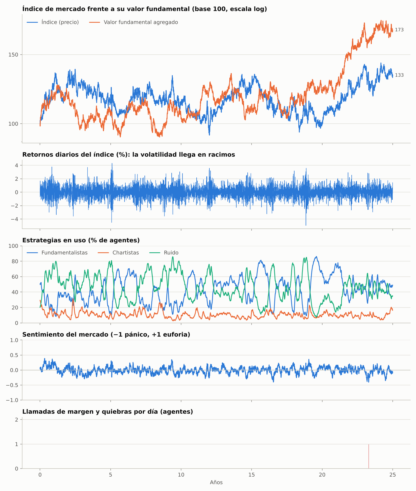
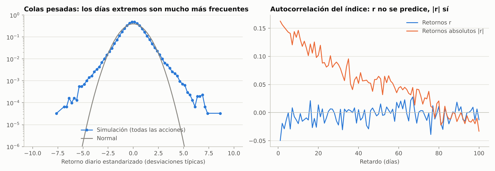
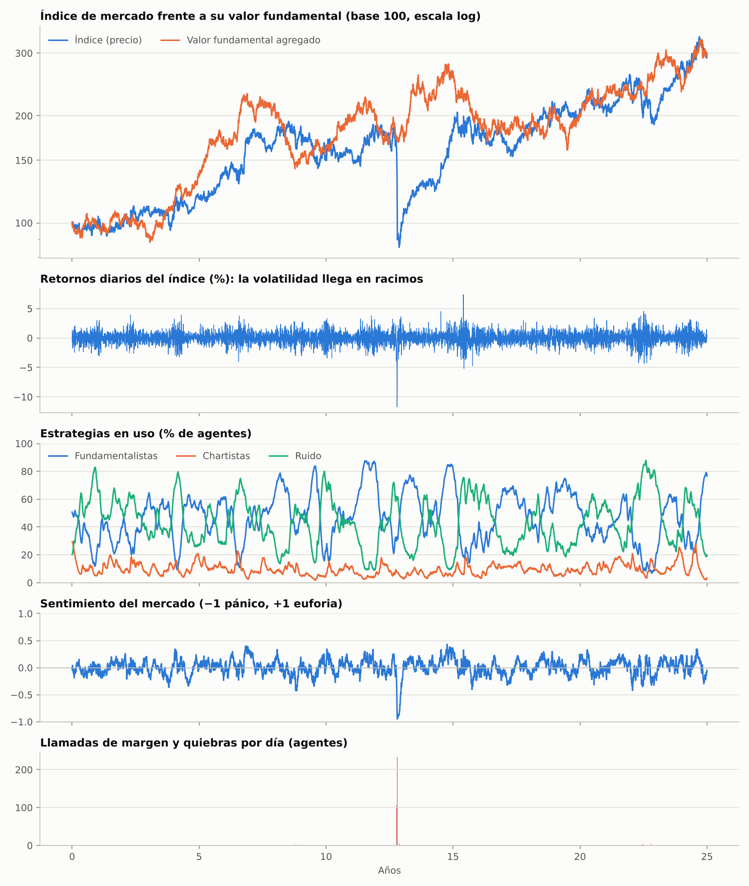
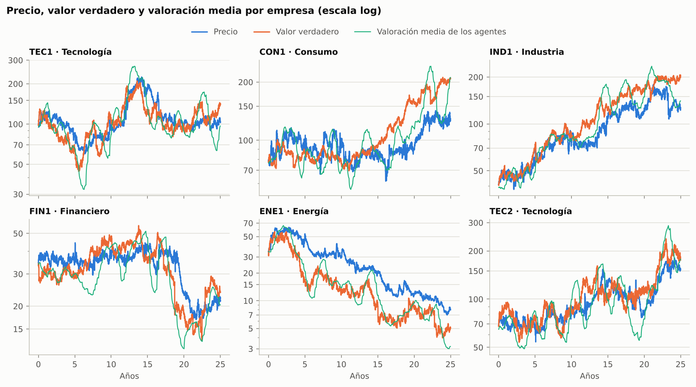
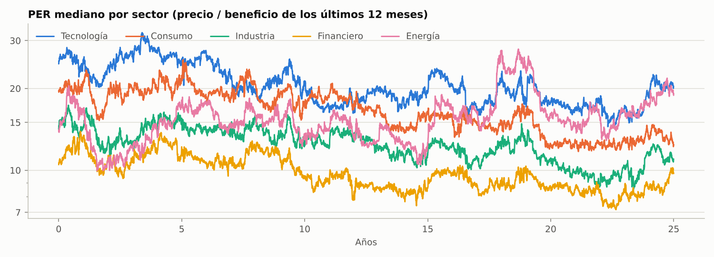

# Mercado financiero artificial basado en agentes

Simulación de un mercado de acciones en el que **los precios no los pone ninguna
ecuación de equilibrio, sino las órdenes de miles de agentes** que valoran
empresas con ratios fundamentales, siguen reglas de análisis técnico y se
equivocan de forma sistemática (sesgos de comportamiento).

El modelo no intenta predecir precios. Se valida comprobando que reproduce los
**hechos estilizados** de los mercados reales: colas pesadas, agrupación de
volatilidad, burbujas, cracs, correlación entre acciones…

* 20 empresas en 5 sectores con estados financieros que evolucionan cada día.
* 2.000 agentes heterogéneos (fundamentalistas, chartistas y minoristas de ruido).
* 25 años de sesiones en unos 30 segundos.
* Cada sesgo se activa o desactiva con un interruptor para medir su efecto.



## Inicio rápido

```bash
pip install -e ".[dev]"

mercado-abm simular                      # fase 2 (todos los sesgos), 25 años
mercado-abm simular --fase 1 --semilla 7 --salida resultados/fase1
mercado-abm comparar --semillas 1,2,3,4  # efecto de cada sesgo, en paralelo
mercado-abm graficos resultados          # regenera los gráficos de una simulación guardada
pytest                                   # 24 tests, ~20 s
```

`simular` imprime la tabla de hechos estilizados y guarda en la carpeta de
salida los gráficos (`mercado.png`, `empresas.png`, `hechos_estilizados.png`,
`ratios.png`), las series en CSV y los resultados completos (`resultados.npz`).

Desde Python:

```python
from mercado_abm import Config, simular
from mercado_abm.metricas import hechos_estilizados, informe

config = Config()
config.comportamiento.apalancamiento = False   # apaga un sesgo
config.agentes.frac_apalancados = 0.25         # o cambia cualquier parámetro
res = simular(config)
print(informe(hechos_estilizados(res)))
```

Cualquier parámetro de `src/mercado_abm/config.py` se puede sobrescribir con
un TOML (ver `configs/`): `mercado-abm simular --config mi_config.toml`.
`configs/apalancamiento_alto.toml` es un escenario de riesgo sistémico con el
25% de agentes apalancados.

## Cómo funciona: cuatro capas

```
 Economía ──► informes trimestrales ──► Agentes valoran y deciden ──► órdenes ──► Creador de mercado ──► precio
    ▲                                        ▲      ▲                                                       │
    │                                        │      └── sesgos: sentimiento, atención, contagio... ◄──────┤
 shocks macro,                               └──────── aprendizaje: qué estrategia ha ganado ◄─────────────┘
 sectoriales y propios
```

### 1. Economía (`economia.py`)

Cada empresa tiene ventas por acción, margen neto, valor contable y deuda. Las
ventas crecen con shocks **macro** (un ciclo económico común), **sectoriales** e
**idiosincráticos**, más saltos ocasionales. Los márgenes se expanden en los
auges y se comprimen en las recesiones. El valor contable acumula beneficios
retenidos y las empresas gestionan su capital para mantener el ROE.

Los agentes **solo ven los resultados trimestrales publicados**, con ruido
contable y en fechas escalonadas. Con ellos se calculan los ratios: PER,
precio/valor contable, ROE, deuda/patrimonio, rentabilidad por dividendo y
crecimiento del BPA.

El **valor verdadero** (que nadie ve) es un Gordon ajustado por reinversión,
con el beneficio normalizado:

```
V = BPA · (1 + g) · (1 − g / ROE) / (r − g),    r = r_libre + β · prima + prima_deuda · D/E
```

Para crecer al ritmo g hay que reinvertir g/ROE del beneficio, así que crecer
solo crea valor si el ROE supera al coste de capital.

### 2. Agentes (`agentes.py`, `estrategias.py`)

Cada agente sigue de 3 a 10 empresas (las grandes atraen más atención). Su
riqueza sigue una distribución de Pareto. Tiene una cartera estratégica larga
y posiciones especulativas, y en cada momento usa una de estas tres estrategias:

| Tipo | Demanda (por empresa) |
|---|---|
| **Fundamentalista** | `φ · (ln V̂ − ln P) + q · calidad + ruido`. La valoración V̂ es un **DCF en dos etapas**: 5 años con el crecimiento percibido y después Gordon. El 20% valora por el **PER mediano del sector**, lo que contagia las burbujas sectoriales. La puntuación de calidad combina ROE alto, poca deuda y crecimiento. |
| **Chartista** | `χ · señal + ruido` con una de 8 reglas: momentum 5/20/60 días, cruce de medias 5/20 y 20/100, RSI-14 (contraria), ruptura de canal de 55 días y soportes/resistencias en números redondos. |
| **Ruido (minorista)** | reacciona a las sorpresas de resultados (sobrerreacción), al sentimiento y al máximo de 52 semanas. |

El ruido de cada tipo es **común** dentro de cada empresa (todos leen las mismas
noticias y los mismos gráficos), con una parte de mercado y otra de sector. Sin
eso el ruido individual se cancelaría al sumar miles de agentes y no habría
volatilidad agregada.

La demanda se convierte en una orden proporcional al capital que el agente
dedica a la empresa, su agresividad y su confianza. Se aplican la prohibición de
cortos (40% de los agentes) y el límite de apalancamiento.

### 3. Irracionalidad (`comportamiento.py`)

| Sesgo | Cómo se modela | Interruptor | Fase |
|---|---|---|---|
| Cambio de estrategia | Logit de Brock-Hommes sobre el rendimiento reciente de cada estrategia, saturado con tanh | `cambio_estrategia` | 1 |
| Contagio (efecto rebaño) | La fracción que ya usa una estrategia entra en el logit (Kirman, Lux-Marchesi); a esto se suma el miedo a la burbuja (`miedo_burbuja · desalineamiento²`, como en Franke-Westerhoff) | `contagio` | 1 |
| Sentimiento | Variable en (−1, 1), persistente y alimentada por los retornos; sesga valoraciones y demanda minorista | `sentimiento` | 1 |
| Atención limitada | Probabilidad de operar `∝ (vol reciente / vol habitual)^0,8`, más noticias. Hay **habituación**: se reacciona a la volatilidad inusual, no a su nivel | `atencion_limitada` | 1 |
| Extrapolación | Crecimiento percibido = mezcla del de largo plazo y el del último año | `extrapolacion` | 1 |
| Conservadurismo | La valoración se ancla a la anterior y se ajusta un 2–10% al día; produce deriva tras los resultados (PEAD) | `conservadurismo` | 2 |
| Aversión a las pérdidas | Los días malos pesan ×2,25 al evaluar estrategias y las caídas llaman ×1,5 más la atención | `aversion_perdidas` | 2 |
| Efecto disposición | Se realizan pronto las ganancias y se mantienen las pérdidas | `efecto_disposicion` | 2 |
| Anclaje | Soportes y resistencias en números redondos; el minorista caza "gangas" cuando el precio está más lejos del máximo anual de lo habitual para su volatilidad | `anclaje` | 2 |
| Exceso de confianza | Confianza innata lognormal con autoatribución: aprende de su rendimiento acumulado frente al de los demás, y los aciertos la suben más de lo que los fallos la bajan. Escala tamaño y frecuencia de las órdenes | `exceso_confianza` | 2 |
| Apalancamiento | El 15% de los agentes se apalanca hasta ×4. Si la exposición supera el límite más un colchón, el bróker vende hasta el 50% al día; si quiebra, entra un inversor nuevo sin apalancar y el apalancamiento se reconstruye despacio (ciclo de Minsky) | `apalancamiento` | 2 |

### 4. Formación del precio (`mercado.py`)

Un creador de mercado ejecuta todas las órdenes y mueve el precio según la
demanda neta relativa al capital de quienes siguen la empresa. El impacto es
lineal para órdenes normales (Kyle) y crece con la raíz cuadrada por encima de
un umbral, como en una venta forzada masiva. La profundidad cae cuando sube la
volatilidad y no baja de la mitad de su media reciente. Como en las bolsas
reales, un interruptor de volatilidad limita el movimiento de una acción en un
día (`limite_diario`, ±0,2 en logaritmo; 0 lo desactiva).

### Un día de simulación (`simulacion.py`)

1. La economía avanza; algunas empresas publican resultados (noticias, opiniones nuevas).
2. Los agentes actualizan sus valoraciones (con conservadurismo).
3. Atención: quién opera hoy y en qué empresas.
4. Demandas y órdenes, efecto disposición y restricciones (cortos, apalancamiento), más las ventas forzadas de ayer.
5. El creador de mercado fija los precios nuevos.
6. Contabilidad: ejecución, reequilibrio pasivo de la cartera estratégica, intereses y dividendos.
7. Aprendizaje: aptitud de cada estrategia, confianza y cambios de estrategia.
8. Llamadas de margen y quiebras (se ejecutan mañana), sentimiento e indicadores técnicos.

## Resultados

### Hechos estilizados

Simulaciones por defecto (semilla 1, 25 años), con `mercado-abm simular` y
`mercado-abm simular --fase 1`:

| Hecho estilizado | Fase 2 | Fase 1 | Rango real orientativo |
|---|---:|---:|---:|
| Volatilidad anual (acciones, mediana) | 21,4% | 20,1% | 15–45% |
| Volatilidad anual (índice) | 13,7% | 13,3% | 10–25% |
| Autocorrelación de retornos (retardo 1) | −0,019 | 0,024 | ±0,05 |
| Curtosis diaria (acciones / índice) | 5,8 / 4,4 | 6,8 / 5,6 | ≥ 5 / ≥ 4 |
| Índice de cola de Hill | 3,2 | 3,1 | 2–5 (≈ 3) |
| Asimetría del índice | −0,007 | +0,096 ✗ | ≤ 0 |
| Agrupación de volatilidad: autocorr. \|r\| retardo 1 / retardo 50 | 0,16 / 0,07 | 0,19 / 0,11 | 0,1–0,45 / 0,02–0,25 |
| Efecto apalancamiento | −0,007 | −0,010 | negativo |
| Correlación volumen–\|r\| | 0,79 | 0,78 | positiva |
| Correlación media entre acciones | 0,33 | 0,33 | 0,15–0,55 |
| Desalineamiento mediano \|ln P/V\| | 18% | 18% | 5–40% |
| Máxima caída del índice | 32% | 40% | 25–75% |

La fase 2 reproduce los 14 hechos estilizados y la fase 1, 13: le falta la
asimetría negativa, porque no tiene ningún mecanismo que la genere.



### Qué aporta cada sesgo

`mercado-abm comparar` ejecuta la fase 1, la fase 2 y la fase 2 quitando cada
sesgo de uno en uno. Medianas de 4 semillas de 25 años:

| Variante | Vol. índice | Curtosis índice | Agrup. vol. | Asimetría | Máx. caída | Peor día | Días < −5% | Quiebras | Chartistas |
|---|---:|---:|---:|---:|---:|---:|---:|---:|---:|
| Fase 1 | 13,3% | 6,7 | 0,20 | +0,02 | 54% | −5,7% | 2,5 | 0 | 19% |
| **Fase 2** | 15,6% | 4,6 | 0,17 | −0,04 | 47% | −5,5% | 2,0 | 32 | 10% |
| sin conservadurismo | 15,2% | 4,4 | 0,15 | +0,03 | 50% | −5,0% | 0,5 | 18 | 10% |
| sin aversión a las pérdidas | 13,7% | 3,5 | 0,07 | −0,03 | 44% | −4,2% | 0 | 7 | 16% |
| sin efecto disposición | 20,8% | 5,8 | 0,23 | −0,12 | 57% | −9,2% | 13,5 | 110 | 9% |
| sin anclaje | 18,8% | 5,6 | 0,24 | −0,07 | 68% | −7,5% | 7 | 141 | 10% |
| sin exceso de confianza | 11,0% | 3,5 | 0,10 | −0,02 | 39% | −3,1% | 0 | 3 | 11% |
| sin apalancamiento | 14,8% | 4,6 | 0,15 | +0,05 | 31% | −5,4% | 0,5 | 0 | 10% |

Hay sesgos que **amplifican** y sesgos que **amortiguan**:

* **Amplificadores.** Sin el exceso de confianza, la volatilidad cae al 11% y
  casi desaparece la agrupación. Sin la aversión a las pérdidas (que hace que
  las caídas llamen más la atención), la agrupación cae de 0,17 a 0,07. Sin el
  apalancamiento no hay quiebras, la máxima caída baja del 47% al 31% y la
  asimetría pasa a ser positiva.
* **Amortiguadores.** El efecto disposición (no vender las perdedoras) y el
  anclaje (comprar cuando "está barata") frenan las ventas de pánico. Si se
  quitan, las caídas alimentan las llamadas de margen: 13,5 días de caídas de
  más del 5% y 110 quiebras sin disposición, y una máxima caída del 68% sin anclaje.
* La fase 2 tiene menos curtosis que la fase 1 porque tiene la mitad de
  chartistas: la aversión a las pérdidas castiga su rendimiento irregular, y
  son ellos quienes generan los regímenes más volátiles.

### Riesgo sistémico: el escenario de apalancamiento alto

Los cracs de un día son sucesos raros. En 8 historias de 25 años aparece uno de
más del 10% tanto con el 15% de agentes apalancados como con el 25%. Pero con el
25% se duplican las quiebras (423 frente a 206 en total) y la caída máxima
mediana del índice pasa del ~40% al ~47%. Esta es la semilla 3 de
`configs/apalancamiento_alto.toml`: el índice cae un 11,7% en un día (lo frena
el interruptor), el sentimiento toca −0,95, unos 230 agentes reciben llamadas
de margen o quiebran el mismo día y el índice pierde más de la mitad antes de
recuperarse en unos dos años.







## Lo que se aprende al calibrarlo

* **La volatilidad agregada nace de errores correlacionados.** Con ruido
  independiente por agente, 2.000 agentes se compensan y el mercado apenas se mueve.
* **Gordon con crecimiento extrapolado explota** cuando g se acerca a r: una
  racha de beneficios multiplica la valoración. El DCF en dos etapas (lo que
  hace un analista real) lo acota.
* **El bucle atención → volatilidad está cerca de un punto crítico.** Sin
  habituación aparece un segundo equilibrio de volatilidad extrema del que el
  mercado no sale. Con habituación (reaccionar a la volatilidad *inusual*), el
  nivel de largo plazo queda fijado y las rachas de volatilidad se disipan solas.
* **El exceso de confianza con aprendizaje asimétrico se alimenta de la propia
  volatilidad.** Si los aciertos diarios suben la confianza más de lo que los
  fallos la bajan, más volatilidad implica más confianza, órdenes más grandes y
  más volatilidad. Hay que aprender del rendimiento acumulado y relativo a los
  demás.
* **Un sesgo con media distinta de cero desplaza el nivel de precios.** Con el
  anclaje al máximo anual con un umbral fijo, los minoristas vendían en neto y el
  mercado quedaba un 16% por debajo de su valor durante 25 años. Con la
  aversión a las pérdidas aplicada al sentimiento, el ánimo derivaba hacia un
  pesimismo permanente. Los sesgos tienen que estar centrados respecto a lo que
  es "normal".
* **El apalancamiento necesita frenos realistas.** Con impacto lineal y
  liquidación inmediata, unas pocas quiebras hundían una acción un 40% en un
  día. Hacen falta impacto cóncavo, liquidación escalonada, interruptores de
  volatilidad y que el apalancamiento se reconstruya despacio tras un crac.
  Cuando las posiciones apalancadas se acercan a la mitad del capital del
  mercado, quitar cualquier amortiguador provoca colapsos.
* **Las restricciones a vender en corto sostienen las sobrevaloraciones**
  (Miller, 1977): los fundamentalistas pesimistas solo pueden vender lo que tienen.
* **Los chartistas pierden peso** (≈10–20% de los agentes): su ruido es el
  mayor y les cuesta dinero en impacto. Si quieres más análisis técnico en
  juego, sube `predisposicion` (el término α₀ de Franke-Westerhoff), sabiendo
  que el mercado se vuelve más volátil.

## Limitaciones

* El precio lo fija un creador de mercado, no un libro de órdenes: no hay
  horquilla ni profundidad por niveles.
* La cartera estratégica se reequilibra contra inversores pasivos externos, sin
  impacto. Las órdenes especulativas y las ventas forzadas sí mueven el precio.
* La calibración es manual, por hechos estilizados y varias semillas, no por el
  Método de Momentos Simulados.
* Las colas del índice (curtosis 4–7) y sobre todo la asimetría y el efecto
  apalancamiento son más débiles que en los datos reales.
* Los resultados varían mucho entre semillas: unas historias tienen un crac y
  otras ninguno. Para sacar conclusiones, usa varias semillas
  (`mercado-abm comparar`).

## Próximos pasos

* **Libro de órdenes** con doble subasta continua (Chiarella-Iori): horquilla,
  profundidad e impacto no lineal emergentes.
* **Calibración por Método de Momentos Simulados** contra series reales (por
  ejemplo, el S&P 500 diario).
* **Experimentos de política**: interruptores de volatilidad, impuesto a las
  transacciones, límites al apalancamiento, shocks de tipos de interés.

## Estructura

```
src/mercado_abm/
  config.py         parámetros por capa, carga de TOML, interruptores de fase
  economia.py       empresas, ciclo macro, informes trimestrales, ratios, valoración
  tecnico.py        indicadores técnicos vectorizados
  agentes.py        población: rasgos, carteras, contabilidad
  estrategias.py    demanda fundamentalista, chartista y de ruido
  comportamiento.py sentimiento, atención, cambio de estrategia, confianza, margen
  mercado.py        creador de mercado
  simulacion.py     bucle diario y resultados
  metricas.py       hechos estilizados
  graficos.py       gráficos y exportación a CSV
  cli.py            línea de comandos
configs/            fase1.toml, fase2.toml, apalancamiento_alto.toml
tests/              pytest
```

## Referencias

* Arthur, Holland, LeBaron, Palmer y Tayler (1997). *Asset pricing under endogenous expectations in an artificial stock market*.
* Brock y Hommes (1998). *Heterogeneous beliefs and routes to chaos in a simple asset pricing model*.
* Chiarella e Iori (2002). *A simulation analysis of the microstructure of double auction markets*.
* Cont (2001). *Empirical properties of asset returns: stylized facts and statistical issues*.
* Franke y Westerhoff (2012). *Structural stochastic volatility in asset pricing dynamics*.
* Kahneman y Tversky (1979). *Prospect theory: an analysis of decision under risk*.
* Kirman (1993). *Ants, rationality, and recruitment*.
* Lux y Marchesi (1999). *Scaling and criticality in a stochastic multi-agent model of a financial market*.
* Miller (1977). *Risk, uncertainty, and divergence of opinion*.
* Shiller (2000). *Irrational Exuberance*.
